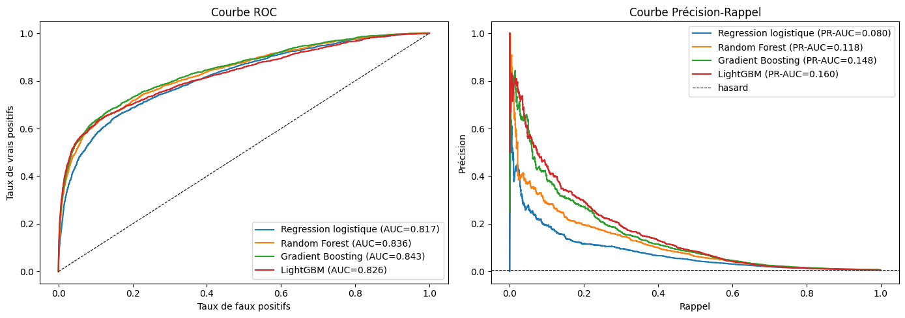
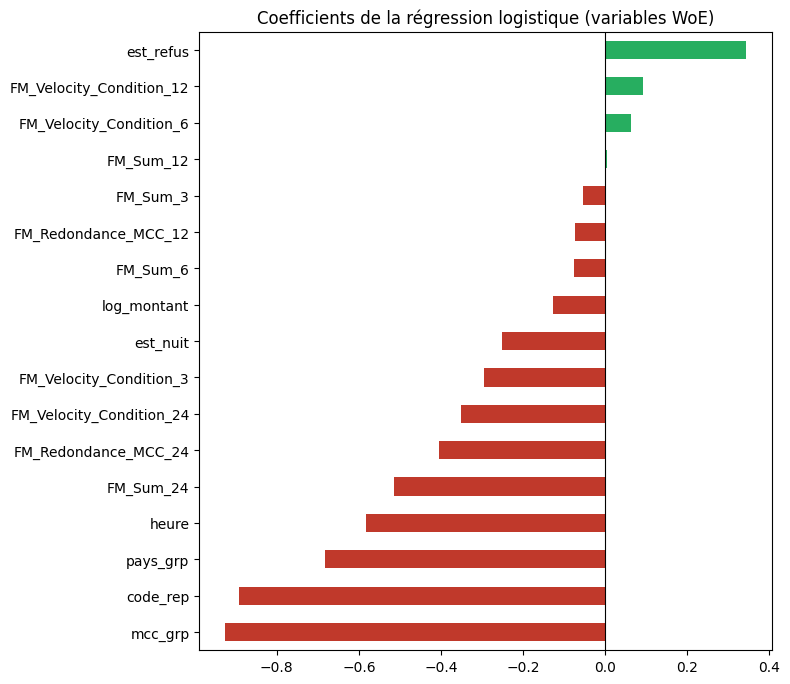

# Credit Card Fraud Detection Scorecard

> 🇫🇷 **Résumé :** construction d'un score de fraude sur 1,15 million d'autorisations de paiement par carte (0,63 % de fraude). Création de variables comportementales (vélocité, montants cumulés sur fenêtres glissantes), encodage WoE et sélection par Information Value (17 variables sur 26), comparaison de 4 modèles. Modèle retenu : LightGBM, **AUC 0,83, Gini 0,65, lift 6,1** sur le premier décile, qui capte **61 % des fraudes**. Projet de groupe, Master 2 TIDE, Université Paris 1 Panthéon-Sorbonne.

Building a fraud score that ranks card payment authorisations from most to least suspicious, so that analysts can focus their controls where they matter most.

| | |
|---|---|
| **Data** | 1,151,432 card authorisations, 198,044 cards, one year |
| **Target** | Fraud flag, highly imbalanced: **0.63 %** (7,246 frauds) |
| **Method** | Behavioural feature engineering, WoE / IV encoding and selection, 4 models compared |
| **Final model** | LightGBM, selected on PR-AUC |
| **Result** | **AUC 0.83 · Gini 0.65 · KS 0.53 · top-decile lift 6.1** (61 % of frauds caught in the top 10 % of scores) |
| **Stack** | Python, pandas, scikit-learn, LightGBM, matplotlib |

## Approach

1. **Data quality and exploration**: no missing values; fraud rates compared by amount, country, merchant category (MCC) and authorisation response code.
2. **Feature engineering**: time features (hour, night, weekday, weekend), log amount, grouping of high-cardinality variables (top 15 countries, top 20 MCCs), and **behavioural features on sliding windows** (3, 6, 12, 24): transaction velocity, cumulative amounts, MCC redundancy, country changes. None of them uses the target, so there is no leakage.
3. **Weight of Evidence & Information Value**: each variable is binned and encoded as WoE, fitted **on the training set only**; variables with IV below 0.02 are dropped (**17 kept out of 26**).
4. **Stratified split**: 75 % train / 25 % test, fraud rate preserved (0.629 % in both).
5. **Models**: a WoE logistic regression (interpretable scorecard) against Random Forest, HistGradientBoosting and LightGBM, with class weighting for the imbalance.
6. **Evaluation**: AUC, Gini, KS, and above all **PR-AUC**, the reference metric when positives are this rare; optimal F1 threshold; decile lift table.
7. **Scorecard scaling**: probabilities converted into points (PDO = 20, reference score 600), as in credit scoring.

## Results

| Model | AUC | Gini | KS | PR-AUC |
|---|---|---|---|---|
| Logistic regression (WoE) | 0.817 | 0.634 | 0.496 | 0.080 |
| Random Forest | 0.836 | 0.672 | 0.525 | 0.118 |
| Gradient Boosting | 0.843 | 0.686 | 0.540 | 0.148 |
| **LightGBM (selected)** | **0.826** | **0.651** | **0.527** | **0.160** |

LightGBM is selected for the best **PR-AUC**: on such a rare event, it is the model that keeps the most precision at a given recall, which is what matters to an analyst reviewing alerts.

**Lift table (LightGBM, test set):** the top decile of scores has a fraud rate of 3.86 % against 0.63 % on average (**lift 6.1**) and concentrates **61.3 %** of all frauds; the top 3 deciles capture 76 %.



**Key drivers:** velocity and cumulative-amount features on sliding windows have by far the highest Information Value (up to 0.90), consistent with fraud patterns made of bursts of purchases.



## Limits and next steps

- The authorisation response code (`CodeRep`) may only be known **after** the authorisation decision. If the score must run before the decision, set `USE_CODEREP = False` to remove this potential leakage.
- Next steps: out-of-time validation (temporal split), probability calibration, specific treatment of high-risk MCCs.

## Repository structure

```
├── notebooks/
│   └── fraud_scoring.ipynb   # full analysis with outputs (comments in French)
├── src/
│   └── fraud_scoring.py      # same pipeline as a script
├── images/                   # figures produced by the notebook
├── requirements.txt
└── README.md
```

## How to run

```bash
pip install -r requirements.txt
# place autorisations.csv in the working directory, then:
python src/fraud_scoring.py            # or open the notebook
SAMPLE_FRAC=0.1 python src/fraud_scoring.py   # quick run on 10 % of the data
```

The dataset was provided for the course and is not redistributed in this repository.

## Context

Group project, Credit Scoring course, Master 2 TIDE (*Traitement de l'Information et Data Science en Entreprise*), Université Paris 1 Panthéon-Sorbonne, 2025-2026.
